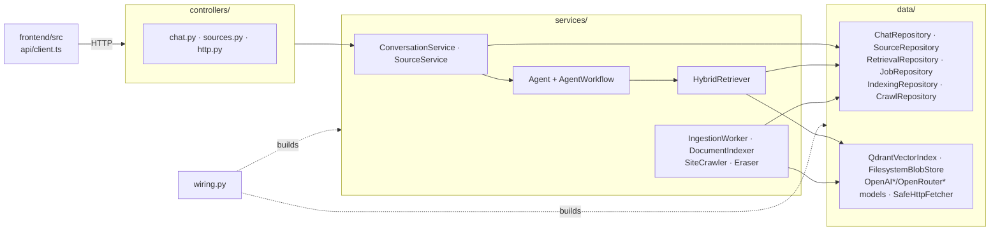
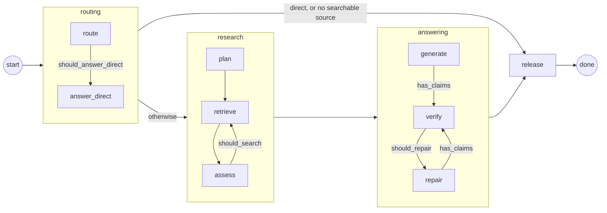
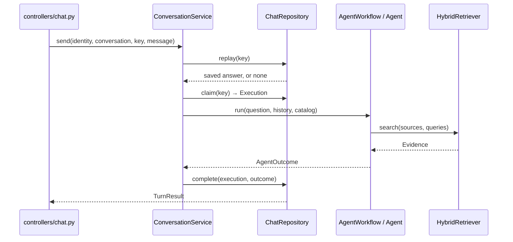
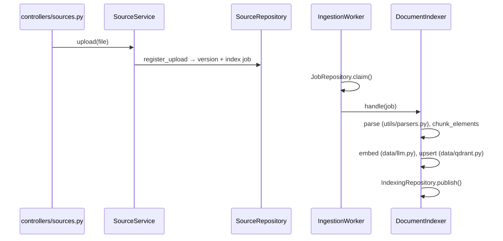

# ContextMesh class map

The backend's classes and how they connect. Paths are under `backend/app/`. For each
user story file by file, with its log lines, see [flows.md](flows.md).

## Layers

- **controllers** translate HTTP; services are read from `app.state`.
- **services** hold the use cases and call `data` classes directly.
- **data** talks to PostgreSQL, Qdrant, blobs, model providers, and the web.
- **wiring.py** is the only place that picks concrete classes: `build_api()` for
  `main.py`, `build_worker()` for `worker.py`.

## Agent graph

`AgentWorkflow.run()` (`services/agent/graph.py`) runs one LangGraph graph. Each node
calls one `Agent` method (`services/agent/steps.py`); edge labels are the `Agent`
conditions that choose the branch.

Every model call goes through `Agent._call()`, which enforces the deadline and token
budget from `AgentPolicy` (`services/agent/state.py`). Prompts and output schemas are
in `services/agent/prompts.py`.

## Asking a question

No database transaction is open while the agent runs. On failure `ChatRepository.fail()`
releases the turn.

## Uploading and indexing a file

Crawls follow the same pattern: `SiteCrawler` records each page with
`CrawlRepository.register_page`, which enqueues normal indexing.

## Interfaces

Only these have more than one implementation.

| Protocol | Implementations | Defined in |
| --- | --- | --- |
| `ReasoningModel` | `OpenAIReasoningModel`, `TracedReasoningModel` | `services/models.py` |
| `EmbeddingModel` | `OpenAIEmbeddingModel`, `TracedEmbeddingModel` | `services/models.py` |
| `DecisionModel` | `OpenRouterDecisionModel`, `TracedDecisionModel` | `services/models.py` |
| `JobHandler` | `DocumentIndexer`, `SiteCrawler`, `Eraser` | `services/indexing.py` |

## Class finder

| Class | File | Role |
| --- | --- | --- |
| `ConversationService` | `services/chat.py` | Conversations and question turns |
| `SourceService` | `services/sources.py` | Sources, uploads, deletes, evidence |
| `Agent` | `services/agent/steps.py` | Every agent step and its budget |
| `AgentWorkflow` | `services/agent/graph.py` | Runs the LangGraph graph, opens the trace |
| `AgentState`, `AgentPolicy` | `services/agent/state.py` | Run state and server-owned limits |
| `HybridRetriever` | `services/retrieval.py` | Vector + keyword search, fusion, rerank |
| `IngestionWorker` | `services/indexing.py` | Claims a job, runs its handler, records failures |
| `DocumentIndexer`, `Eraser` | `services/indexing.py` | Index a version; clean up after deletes |
| `SiteCrawler`, `Frontier`, `RobotsRules` | `services/crawler.py` | Bounded same-site crawl |
| `ChatRepository` | `data/chat.py` | Conversations, turns, saved answers |
| `SourceRepository` | `data/sources.py` | Sources, documents, versions |
| `RetrievalRepository` | `data/retrieval.py` | Catalog, keyword search, passage hydration |
| `JobRepository` | `data/jobs.py` | Durable job queue with leases |
| `IndexingRepository`, `CrawlRepository` | `data/indexing.py` | Worker writes: publish, crawl results |
| `QdrantVectorIndex` | `data/qdrant.py` | Vector index |
| `FilesystemBlobStore` | `data/blobs.py` | Uploaded and crawled file bytes |
| `OpenAIReasoningModel`, `OpenAIEmbeddingModel`, `OpenRouterDecisionModel` | `data/llm.py` | Model clients |
| `SafeHttpFetcher` | `data/fetcher.py` | Web fetches to public addresses only |
| `LangSmithTracing`, `Traced*` | `data/tracing.py` | Optional LangSmith tracing |
| `ContextMeshError` | `utils/errors.py` | Error code → HTTP status and message |
| `Settings` | `utils/config.py` | Configuration from `.env` |
